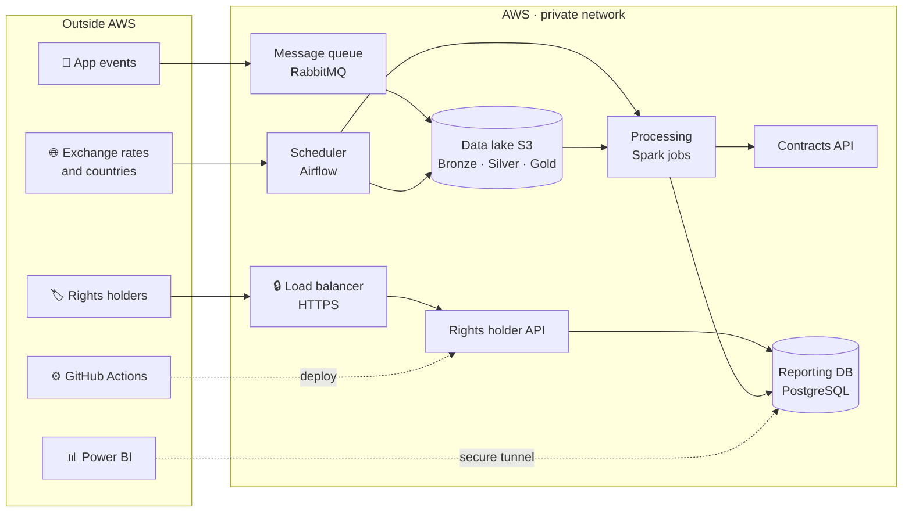

# Architecture

:::tip At a glance
- **Cloud:** AWS, region us-east-1, built entirely with **Terraform**.
- **Principle:** the cheapest option that meets each requirement.
- **Security:** only the load balancer is public; everything else is private.
- **Cost:** about **30–40 USD for the whole project** (environment off by default, ADR-0020).
- **Status:** accepted design (ADR-0001). **Not deployed to AWS yet.**
:::

## The big picture

## Building blocks

| Layer | What it does | AWS service |
|---|---|---|
| **Entry** | The only public door, HTTPS only | Application Load Balancer + certificate (ACM) |
| **Applications** | Rights holder API, contracts API, event simulator and consumer | ECS Fargate containers |
| **Messaging** | Holds events so none are lost | RabbitMQ on a small EC2 server |
| **Scheduling** | Runs the daily and monthly jobs | Airflow on EC2 |
| **Processing** | Validates plays and calculates royalties; runs only when needed | Spark on Fargate Spot |
| **Storage** | Raw and processed data; reports | S3 data lake + RDS PostgreSQL |
| **Security** | Secrets, access and audit | SSM Parameter Store, IAM, CloudTrail |
| **Operations** | Logs, alarms and budget alerts | CloudWatch, AWS Budgets + SNS |
| **Delivery** | Build, test and deploy without stored keys | GitHub Actions + OIDC, Amazon ECR |

## Design principles

1. **Off by default.** The environment is created only for short test windows and kept on only during the final week, until the demo. Then it is destroyed.
2. **Lowest justifiable cost.** Each service is the cheapest one that meets a course topic, business rule or requirement.
3. **Only the load balancer is public.** Compute and data live in private subnets. The team connects through SSM Session Manager, with no open ports.
4. **No secrets in code.** Secrets live in SSM Parameter Store; GitHub connects to AWS with OIDC.
5. **Everything as code.** Terraform creates and destroys all resources.
6. **Encrypted and audited from day one.** Data is encrypted at rest, traffic uses HTTPS, and CloudTrail records every action.

## Estimated cost

| Scenario | Approx. USD |
|---|---|
| Everything on for 6 weeks (rejected) | 165–170 |
| Test windows in Sprints 3–5 | 3–8 |
| Final week, on until the demo | 27–30 |
| Always-kept resources (Terraform state, images, secrets, budgets, audit) | under 2 |
| **Total with ADR-0020** | **≈ 30–40** (without EKS) |

The biggest costs are the load balancer, the Airflow server and the database. Amazon EKS is turned on only for its Sprint 5 test and the demo (0.10 USD per hour plus nodes).

## Main risks

| Risk | Mitigation |
|---|---|
| The NAT instance is a single point of failure | CloudWatch alarm with automatic recovery; S3 traffic uses a free private endpoint |
| Spot capacity can interrupt jobs | Manual message acknowledgement and retries; the monthly job can move to on-demand |
| Single-AZ database | Acceptable for an academic project, with 7-day automatic backups |
| No own domain → self-signed certificate | Document it in the demo, or buy a cheap domain if approved |

## Technical details

<strong>Detailed architecture diagram</strong>

Editable source: `sonoraplay-arquitectura-v1.drawio` in the code repository (open it with [diagrams.net](https://app.diagrams.net)).

<strong>Full list of services</strong>

"Always on" means active while the environment is running. "Kept" means it stays between test windows because it costs almost nothing.

| Layer | Service | Size / mode | Availability |
|---|---|---|---|
| Network | VPC with 2 availability zones, public and private subnets | 10.0.0.0/16 | Always on |
| Internet exit | NAT instance (EC2 t4g.nano), ~90 % cheaper than a NAT Gateway | — | Always on |
| S3 access | S3 gateway endpoint (free) | — | Always on |
| Entry | Application Load Balancer, port 80 redirects to 443 | 1 ALB | Always on |
| Certificate | AWS Certificate Manager | 1 certificate | Kept |
| Rights holder API | ECS Fargate On-Demand, ARM64 | 0.25 vCPU / 0.5 GB | Always on |
| Contracts API | ECS Fargate On-Demand, ARM64, private DNS only | 0.25 vCPU / 0.5 GB | Always on |
| Service discovery | AWS Cloud Map (`sonoraplay.local`) | — | Always on |
| Event simulator | ECS Fargate Spot | 0.25 vCPU / 0.5 GB | Always on |
| Event consumer → Bronze | ECS Fargate Spot, manual ACK | 0.25 vCPU / 0.5 GB | Always on |
| Messaging | RabbitMQ on EC2 | t4g.small | Always on |
| Orchestration | Airflow (CeleryExecutor) on EC2, also the SSM jump host | t4g.medium | Always on |
| Processing | Spark tasks on ECS Fargate Spot | 2 vCPU / 8 GB per job | On demand |
| Data lake | S3 Bronze / Silver / Gold, Parquet by year/month/country, encrypted | — | Kept |
| Database | RDS PostgreSQL, Single-AZ, encrypted, 7-day backups | db.t4g.micro, 20 GB | Always on |
| Images | Amazon ECR (arm64) | — | Kept |
| Secrets | SSM Parameter Store (SecureString) | Standard tier | Kept |
| Monitoring | CloudWatch Logs and alarms, 7-day retention | — | Kept |
| Audit | AWS CloudTrail to an audit bucket | 1 trail | Kept |
| Cost control | AWS Budgets + SNS email | 1 budget | Kept |
| Kubernetes | Amazon EKS | 1 component | Sprint 5 test and demo only |
| Infrastructure as code | Terraform | — | — |
| CI/CD | GitHub Actions + OIDC | — | — |
| Analytics | Power BI Desktop through an SSM tunnel to RDS | — | — |

<strong>Network security rules</strong>

Each security group accepts traffic only from another security group, except the load balancer.

| Security group | Allowed inbound | From |
|---|---|---|
| `sg-alb` | 443 (and 80 to redirect) | Internet |
| `sg-api-titulares` | 8000 | `sg-alb` |
| `sg-api-contratos` | 8000 | `sg-spark` |
| `sg-rds` | 5432 | Both APIs, Spark and the Airflow host |
| `sg-rabbitmq` | 5672 | Simulator, consumer and Airflow |
| `sg-airflow` | None | Web UI only through an SSM tunnel |
| `sg-nat` | All | Only the VPC |
| `sg-spark`, `sg-simulador`, `sg-consumidor` | None | Outbound only |

<strong>Data flows (numbers in the detailed diagram)</strong>

| # | Flow |
|---|---|
| 1–3 | A rights holder calls the API over HTTPS with a token; the API reads their settlement from the database. Another holder's data returns 403. |
| 4–6 | The simulator publishes events to RabbitMQ; the consumer writes them to S3 Bronze and then acknowledges them. |
| 7 | Airflow launches the Spark jobs: daily (Silver) and monthly on day 3 (Gold). |
| 8 | Spark turns Bronze into Silver (sessions, validity, fraud) and Silver into Gold (settlement), asking the contracts API for each percentage. |
| 9 | Spark loads the dimensional model and the settlement into the database (append-only). |
| 10 | Airflow downloads exchange rates (F6) and countries (F7) and stores them in Bronze. |
| 11 | GitHub Actions builds images, pushes them to ECR and deploys to ECS. |
| 12 | Power BI opens an SSM tunnel through the Airflow host to the database. |
| 13 | CloudTrail records account actions in the audit bucket. |

The catalog (F1) is loaded once into Bronze.

<strong>What was kept and dropped from the reference architecture</strong>

| Reference | SonoraPlay | Reason |
|---|---|---|
| Load balancer | Kept (ALB) | Required by the course |
| EC2 + Auto Scaling | Replaced by ECS Fargate | No servers to patch; pay per container |
| RDS with backups | Kept | 7-day automatic backups |
| Amazon S3 | Kept as the data lake | — |
| Email notifications | Kept as Budgets + SNS | Cost and health alerts |
| DynamoDB sessions | Dropped | The API uses signed tokens, no sessions |
| Memcache | Dropped | No requirement asks for a cache |
| Amazon SES | Dropped | No emails to rights holders |

Not included in this version: AWS WAF and GuardDuty (could add), interface VPC endpoints, CloudFront, staging VPC and a second region (won't do).

:::note Full record
[arquitectura-v1.md](https://github.com/sonoraplay/main/blob/main/docs/arquitectura/arquitectura-v1.md) and [ADR-0001](https://github.com/sonoraplay/main/blob/main/docs/adr/0001-arquitectura-base-aws.md) in the code repository.
:::
