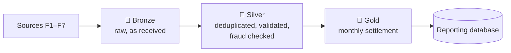

# Data

:::tip In short
Seven data sources (**F1–F7**) feed a data lake with three layers: **Bronze** (raw), **Silver** (clean) and **Gold** (ready for settlement). All data is simulated or public, and every dataset can be regenerated exactly with a fixed seed.
:::

## Data lake layers

| Layer | Contents |
|---|---|
| **Bronze** | Events and files exactly as received, never modified |
| **Silver** | Clean listening sessions, valid plays, fraud flags, plays in quarantine |
| **Gold** | Revenue pools and royalties per rights holder, country and month |

Files are stored as **Parquet**, partitioned by year, month and country.

## Data sources

### F1 · Music catalog

The public **Spotify Tracks** dataset (Kaggle). It is cleaned to **one row per track**: the main genre comes from the most popular row and other genres go to a separate table. Each main artist is assigned to one rights holder.

### F2 · Playback events

Events sent by the app: `start`, `pause`, `resume`, `skip` and `end`. Every event has a unique ID (used to remove duplicates), the device time and the server time (both in UTC), the track position and whether it was offline.

<strong>Event fields</strong>

| Field | Meaning |
|---|---|
| `schema_version` | Always `1.0` |
| `event_id` | Unique ID; retries reuse it |
| `event_type` | `start`, `pause`, `resume`, `skip`, `end` |
| `user_id` | Listening account (F3) |
| `device_id` | Device identifier |
| `track_id` | Track (F1), 22 characters |
| `session_id` | One playback of one track |
| `device_ts` | When it happened on the device (UTC) |
| `server_ts` | When the server received it (UTC) |
| `position_ms` | Position in the track |
| `country_playback` | Country where it was played (for exclusions, not for the pool) |
| `is_offline` | Listened offline and synced later |

A "seek" is sent as a `pause` followed by a `resume` at the new position.

A **simulator** generates realistic, repeatable events for testing, including the edge cases of the rules (29 s, exactly 30 s, a pause in the middle, and 11 plays in one day).

### F3 · Subscriptions

A PostgreSQL database with users, plans, family groups, subscription periods and payments.

| Plan | USD / month | Members | Share of users |
|---|---:|---:|---:|
| Free | 0.00 | 1 | 45 % |
| Individual | 5.99 | 1 | 30 % |
| Family | 9.99 | up to 6 | 10 % |
| Student | 2.99 | 1 | 15 % |

These prices are simulation assumptions. A user has only one active subscription; a family plan has a single payment.

### F4 · Contracts

Contract conditions per rights holder: royalty **percentage**, **validity dates** and **excluded countries**. Some holders change percentage in the middle of a month (one period ends on the 14th, the next starts on the 15th), to test RN-07.

### F5 · Advertising revenue

A simulated monthly CSV with advertising revenue for the six countries, in local currency.

### F6 · Exchange rates

Daily exchange rates from the public **Frankfurter** API (USD base; ARS, BRL, CLP, COP, MXN, PEN). The month-end rate is used to convert revenue to USD. The exact source and weekend rule are still a **proposal** (ADR-0021).

### F7 · Countries

Country codes, regions and currencies from the public **REST Countries** API.

## Data quality

- Duplicate events are removed by `event_id`.
- Sessions with inconsistent data or unknown tracks go to **quarantine** instead of being paid.
- Clock differences between device and server are corrected for online sessions.
- Test data includes deliberate defects (missing end, wrong clock, unknown track, duplicates) to prove they are handled.

:::note Full records
[F2 events](https://github.com/sonoraplay/main/blob/main/docs/datos/eventos-f2.md) · [F3 model](https://github.com/sonoraplay/main/blob/main/docs/datos/modelo-f3.md) · [F4 model](https://github.com/sonoraplay/main/blob/main/docs/datos/modelo-f4.md) · [Simulator](https://github.com/sonoraplay/main/blob/main/docs/datos/simulador-f2.md) · [Offline attribution](https://github.com/sonoraplay/main/blob/main/docs/datos/atribucion-offline.md) · [F5–F7](https://github.com/sonoraplay/main/blob/main/docs/datos/eg30-fuentes-f5-f6-f7.md)
:::
