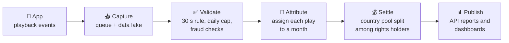

# How It Works

:::tip In short
A play travels from the app to a monthly royalty report in **five steps**: capture → validate → attribute → settle → publish.
:::

## 1. Capture

The app sends small events every time a user starts, pauses, resumes, skips or finishes a track. Each event has a unique ID, so if the phone sends it twice, it is counted once. Events go into a durable queue and are saved untouched in the **Bronze** layer of the data lake. Nothing is lost, even if a server restarts.

## 2. Validate

Events are grouped into listening sessions and checked against the rules:

- A play is **valid** only if the user listened **30 seconds in a row**.
- Only the first **10 valid plays** per user, track and day are paid.
- Accounts that behave like **stream farms** (too many hours, one tiny artist, many accounts on one device) are set aside for review.

The cleaned result is stored in the **Silver** layer.

## 3. Attribute

Each valid play is assigned to a **settlement month**. Offline plays (listened without internet and synced later) still count for the month they were heard, if they sync by day 2 of the next month at 23:59 UTC. Later syncs are paid as an **adjustment** in the next open month.

## 4. Settle

On **day 3** of every month, the platform:

1. Builds a **revenue pool per country**: 52 % of net subscription revenue plus 45 % of advertising revenue.
2. Splits the pool among rights holders according to their share of valid plays.
3. Applies each holder's **contract percentage** valid on the date of each play.
4. Rounds to the cent so the total never exceeds the pool.

The result goes to the **Gold** layer and to the reporting database.

## 5. Publish

- **Rights holders** log in to the API and see only their own report, with the settlement ID and the plays behind every amount.
- **SonoraPlay** teams use Power BI dashboards for royalties, consumption and churn.
- A published month is **never edited**. A correction creates a new settlement version, so the history stays intact.

## Where the data comes from

| Source | What it is | Example use |
|---|---|---|
| **F1** | Music catalog (Spotify tracks dataset, Kaggle) | Which rights holder owns each track |
| **F2** | Playback events from the app (simulated) | Which plays are valid |
| **F3** | Subscriptions, plans and payments (PostgreSQL) | Subscription revenue and billing country |
| **F4** | Rights holder contracts (PostgreSQL) | Royalty percentage and excluded countries |
| **F5** | Monthly advertising revenue (simulated CSV) | Advertising part of the pool |
| **F6** | Currency exchange rates (Frankfurter API) | Convert local currency to USD |
| **F7** | Country information (REST Countries API) | Country codes and currencies |

See [Data](./data.md) for more detail.
