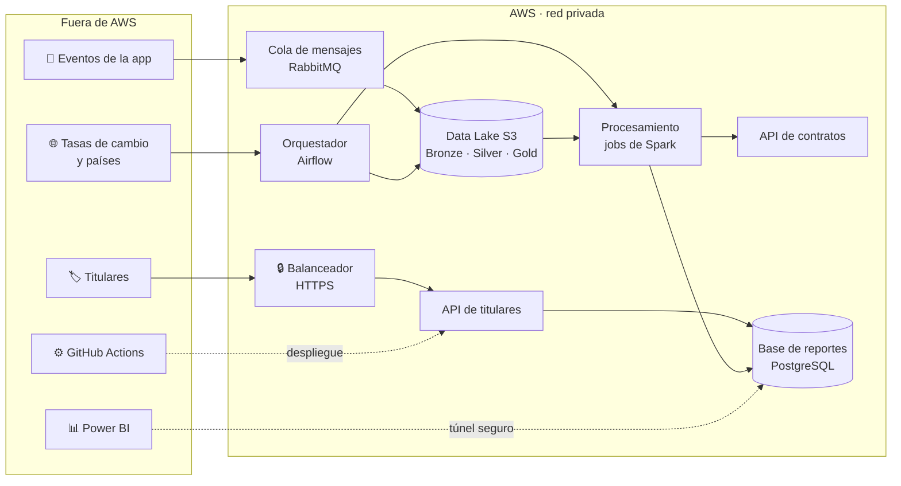

# Arquitectura

:::tip De un vistazo
- **Nube:** AWS, región us-east-1, construida por completo con **Terraform**.
- **Principio:** la opción más barata que cumple cada requisito.
- **Seguridad:** solo el balanceador es público; todo lo demás es privado.
- **Costo:** unos **30–40 USD para todo el proyecto** (entorno apagado por defecto, ADR-0020).
- **Estado:** diseño aceptado (ADR-0001). **Todavía no está desplegado en AWS.**
:::

## La vista general

## Bloques principales

| Capa | Qué hace | Servicio de AWS |
|---|---|---|
| **Entrada** | La única puerta pública, solo HTTPS | Application Load Balancer + certificado (ACM) |
| **Aplicaciones** | API de titulares, API de contratos, simulador y consumidor de eventos | Contenedores en ECS Fargate |
| **Mensajería** | Guarda los eventos para que ninguno se pierda | RabbitMQ en un servidor EC2 pequeño |
| **Orquestación** | Lanza los procesos diarios y mensuales | Airflow en EC2 |
| **Procesamiento** | Valida reproducciones y calcula regalías; solo corre cuando hace falta | Spark en Fargate Spot |
| **Almacenamiento** | Datos crudos y procesados; reportes | Data Lake en S3 + RDS PostgreSQL |
| **Seguridad** | Secretos, accesos y auditoría | SSM Parameter Store, IAM, CloudTrail |
| **Operación** | Logs, alarmas y alertas de presupuesto | CloudWatch, AWS Budgets + SNS |
| **Entrega** | Construir, probar y desplegar sin llaves guardadas | GitHub Actions + OIDC, Amazon ECR |

## Principios de diseño

1. **Apagado por defecto.** El entorno se crea solo en ventanas cortas de prueba y queda prendido solo en la última semana, hasta la demo. Después se destruye.
2. **Menor costo justificable.** Cada servicio es el más barato que cumple un tema del curso, una regla de negocio o un requisito.
3. **Solo el balanceador es público.** El cómputo y los datos van en subredes privadas. El equipo entra con SSM Session Manager, sin puertos abiertos.
4. **Ningún secreto en el código.** Los secretos viven en SSM Parameter Store; GitHub entra a AWS con OIDC.
5. **Todo como código.** Terraform crea y destruye todos los recursos.
6. **Cifrado y auditoría desde el inicio.** Los datos se cifran en reposo, el tráfico usa HTTPS y CloudTrail registra cada acción.

## Costo estimado

| Escenario | USD aprox. |
|---|---|
| Todo prendido 6 semanas (descartado) | 165–170 |
| Ventanas de prueba en los Sprints 3–5 | 3–8 |
| Última semana, prendido hasta la demo | 27–30 |
| Recursos que se conservan (estado de Terraform, imágenes, secretos, presupuesto, auditoría) | menos de 2 |
| **Total con ADR-0020** | **≈ 30–40** (sin EKS) |

Lo que más pesa es el balanceador, el servidor de Airflow y la base de datos. Amazon EKS se prende solo para su prueba en el Sprint 5 y para la demo (0,10 USD por hora más los nodos).

## Riesgos principales

| Riesgo | Mitigación |
|---|---|
| La instancia NAT es un punto único de falla | Alarma de CloudWatch con recuperación automática; el tráfico a S3 va por un endpoint privado gratuito |
| La capacidad Spot puede interrumpir procesos | Confirmación manual de mensajes y reintentos; el proceso mensual puede pasar a On-Demand |
| Base de datos en una sola zona | Aceptable para un proyecto académico, con backups automáticos de 7 días |
| Sin dominio propio → certificado autofirmado | Documentarlo en la demo, o comprar un dominio barato si se aprueba |

## Detalles técnicos

<strong>Diagrama detallado de la arquitectura</strong>

Fuente editable: `sonoraplay-arquitectura-v1.drawio` en el repositorio de código (se abre con [diagrams.net](https://app.diagrams.net)).

<strong>Lista completa de servicios</strong>

"Siempre activo" significa activo mientras el entorno está prendido. "Se conserva" significa que se mantiene entre ventanas de prueba porque cuesta casi nada.

| Capa | Servicio | Tamaño / modo | Disponibilidad |
|---|---|---|---|
| Red | VPC con 2 zonas de disponibilidad, subredes públicas y privadas | 10.0.0.0/16 | Siempre activo |
| Salida a internet | Instancia NAT (EC2 t4g.nano), ~90 % más barata que un NAT Gateway | — | Siempre activo |
| Acceso a S3 | Endpoint gateway de S3 (gratis) | — | Siempre activo |
| Entrada | Application Load Balancer, el puerto 80 redirige al 443 | 1 ALB | Siempre activo |
| Certificado | AWS Certificate Manager | 1 certificado | Se conserva |
| API de titulares | ECS Fargate On-Demand, ARM64 | 0,25 vCPU / 0,5 GB | Siempre activo |
| API de contratos | ECS Fargate On-Demand, ARM64, solo DNS privado | 0,25 vCPU / 0,5 GB | Siempre activo |
| Descubrimiento de servicios | AWS Cloud Map (`sonoraplay.local`) | — | Siempre activo |
| Simulador de eventos | ECS Fargate Spot | 0,25 vCPU / 0,5 GB | Siempre activo |
| Consumidor de eventos → Bronze | ECS Fargate Spot, ACK manual | 0,25 vCPU / 0,5 GB | Siempre activo |
| Mensajería | RabbitMQ en EC2 | t4g.small | Siempre activo |
| Orquestación | Airflow (CeleryExecutor) en EC2, también host de salto SSM | t4g.medium | Siempre activo |
| Procesamiento | Tareas de Spark en ECS Fargate Spot | 2 vCPU / 8 GB por job | Bajo demanda |
| Data Lake | S3 Bronze / Silver / Gold, Parquet por año/mes/país, cifrado | — | Se conserva |
| Base de datos | RDS PostgreSQL, una zona, cifrada, backups de 7 días | db.t4g.micro, 20 GB | Siempre activo |
| Imágenes | Amazon ECR (arm64) | — | Se conserva |
| Secretos | SSM Parameter Store (SecureString) | Nivel estándar | Se conserva |
| Monitoreo | CloudWatch Logs y alarmas, retención de 7 días | — | Se conserva |
| Auditoría | AWS CloudTrail hacia un bucket de auditoría | 1 trail | Se conserva |
| Control de costos | AWS Budgets + SNS por correo | 1 presupuesto | Se conserva |
| Kubernetes | Amazon EKS | 1 componente | Solo prueba del Sprint 5 y demo |
| Infraestructura como código | Terraform | — | — |
| CI/CD | GitHub Actions + OIDC | — | — |
| Analítica | Power BI Desktop por túnel SSM hacia RDS | — | — |

<strong>Reglas de seguridad de red</strong>

Cada Security Group solo acepta tráfico de otro Security Group, salvo el del balanceador.

| Security Group | Entrada permitida | Desde |
|---|---|---|
| `sg-alb` | 443 (y 80 para redirigir) | Internet |
| `sg-api-titulares` | 8000 | `sg-alb` |
| `sg-api-contratos` | 8000 | `sg-spark` |
| `sg-rds` | 5432 | Las dos APIs, Spark y el host de Airflow |
| `sg-rabbitmq` | 5672 | Simulador, consumidor y Airflow |
| `sg-airflow` | Ninguna | La interfaz web solo por túnel SSM |
| `sg-nat` | Todo | Solo la VPC |
| `sg-spark`, `sg-simulador`, `sg-consumidor` | Ninguna | Solo salida |

<strong>Flujos de datos (números del diagrama detallado)</strong>

| # | Flujo |
|---|---|
| 1–3 | Un titular llama a la API por HTTPS con su token; la API lee su liquidación en la base de datos. Pedir datos de otro titular devuelve 403. |
| 4–6 | El simulador publica eventos en RabbitMQ; el consumidor los escribe en S3 Bronze y después los confirma. |
| 7 | Airflow lanza los jobs de Spark: el diario (Silver) y el mensual del día 3 (Gold). |
| 8 | Spark convierte Bronze en Silver (sesiones, validez, fraude) y Silver en Gold (liquidación), y consulta cada % en la API de contratos. |
| 9 | Spark carga el modelo dimensional y la liquidación en la base de datos (append-only). |
| 10 | Airflow descarga las tasas de cambio (F6) y los países (F7) y los guarda en Bronze. |
| 11 | GitHub Actions construye las imágenes, las sube a ECR y despliega en ECS. |
| 12 | Power BI abre un túnel SSM a través del host de Airflow hacia la base de datos. |
| 13 | CloudTrail registra las acciones de la cuenta en el bucket de auditoría. |

El catálogo (F1) se carga una sola vez en Bronze.

<strong>Qué se mantuvo y qué se descartó de la arquitectura de referencia</strong>

| Referencia | SonoraPlay | Motivo |
|---|---|---|
| Balanceador | Se mantiene (ALB) | Lo exige el curso |
| EC2 + Auto Scaling | Se reemplaza por ECS Fargate | No hay servidores que parchear; se paga por contenedor |
| RDS con backups | Se mantiene | Backups automáticos de 7 días |
| Amazon S3 | Se mantiene como Data Lake | — |
| Notificaciones por correo | Se mantiene como Budgets + SNS | Alertas de costo y de salud |
| Sesiones en DynamoDB | Se descarta | La API usa tokens firmados, sin sesiones |
| Memcache | Se descarta | Ningún requisito pide caché |
| Amazon SES | Se descarta | No se envían correos a los titulares |

No se incluyen en esta versión: AWS WAF y GuardDuty (se podrían agregar), endpoints de interfaz de la VPC, CloudFront, VPC de staging y una segunda región (no se harán).

:::note Registro completo
[arquitectura-v1.md](https://github.com/sonoraplay/main/blob/main/docs/arquitectura/arquitectura-v1.md) y [ADR-0001](https://github.com/sonoraplay/main/blob/main/docs/adr/0001-arquitectura-base-aws.md) en el repositorio de código.
:::
