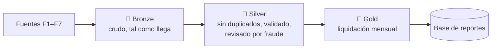

# Datos

:::tip En pocas palabras
Siete fuentes de datos (**F1–F7**) alimentan un Data Lake de tres capas: **Bronze** (crudo), **Silver** (limpio) y **Gold** (listo para liquidar). Todos los datos son simulados o públicos, y cada conjunto se puede regenerar exactamente igual con una semilla fija.
:::

## Capas del Data Lake

| Capa | Contenido |
|---|---|
| **Bronze** | Eventos y archivos tal como llegan, nunca se modifican |
| **Silver** | Sesiones de escucha limpias, reproducciones válidas, marcas de fraude, reproducciones en cuarentena |
| **Gold** | Bolsas y regalías por titular, país y mes |

Los archivos se guardan en **Parquet**, particionados por año, mes y país.

## Fuentes de datos

### F1 · Catálogo musical

El dataset público **Spotify Tracks** (Kaggle). Se limpia a **una fila por pista**: el género principal sale de la fila más popular y los demás géneros van a una tabla aparte. Cada artista principal se asigna a un titular.

### F2 · Eventos de reproducción

Eventos que envía la app: `start`, `pause`, `resume`, `skip` y `end`. Cada evento tiene un ID único (para quitar duplicados), la hora del dispositivo y la del servidor (ambas en UTC), la posición en la pista y si fue offline.

<strong>Campos del evento</strong>

| Campo | Significado |
|---|---|
| `schema_version` | Siempre `1.0` |
| `event_id` | ID único; los reintentos lo reutilizan |
| `event_type` | `start`, `pause`, `resume`, `skip`, `end` |
| `user_id` | Cuenta que escucha (F3) |
| `device_id` | Identificador del dispositivo |
| `track_id` | Pista (F1), 22 caracteres |
| `session_id` | Una reproducción de una pista |
| `device_ts` | Cuándo ocurrió en el dispositivo (UTC) |
| `server_ts` | Cuándo lo recibió el servidor (UTC) |
| `position_ms` | Posición en la pista |
| `country_playback` | País donde se escuchó (para exclusiones, no para la bolsa) |
| `is_offline` | Escuchado sin conexión y sincronizado después |

Un "salto" (seek) se envía como un `pause` seguido de un `resume` en la nueva posición.

Un **simulador** genera eventos realistas y repetibles para las pruebas, incluidos los casos límite de las reglas (29 s, exactamente 30 s, una pausa en medio y 11 reproducciones en un día).

### F3 · Suscripciones

Una base PostgreSQL con usuarios, planes, grupos familiares, períodos de suscripción y pagos.

| Plan | USD / mes | Miembros | Proporción de usuarios |
|---|---:|---:|---:|
| Gratuito | 0,00 | 1 | 45 % |
| Individual | 5,99 | 1 | 30 % |
| Familiar | 9,99 | hasta 6 | 10 % |
| Estudiante | 2,99 | 1 | 15 % |

Estos precios son supuestos de la simulación. Un usuario tiene una sola suscripción activa; un plan familiar tiene un solo pago.

### F4 · Contratos

Las condiciones del contrato de cada titular: **% de regalía**, **fechas de vigencia** y **países excluidos**. Algunos titulares cambian de % a mitad de mes (un período termina el 14 y el siguiente empieza el 15) para probar RN-07.

### F5 · Ingresos publicitarios

Un CSV mensual simulado con los ingresos publicitarios de los seis países, en moneda local.

### F6 · Tasas de cambio

Tasas de cambio diarias de la API pública **Frankfurter** (base USD; ARS, BRL, CLP, COP, MXN, PEN). La tasa del cierre de mes se usa para convertir los ingresos a USD. La fuente exacta y la regla para fines de semana todavía son una **propuesta** (ADR-0021).

### F7 · Países

Códigos de país, regiones y monedas de la API pública **REST Countries**.

## Calidad de datos

- Los eventos duplicados se eliminan por `event_id`.
- Las sesiones con datos inconsistentes o pistas desconocidas van a **cuarentena** en vez de pagarse.
- Las diferencias de reloj entre el dispositivo y el servidor se corrigen en las sesiones online.
- Los datos de prueba incluyen defectos a propósito (sin fin, reloj desfasado, pista desconocida, duplicados) para demostrar que se manejan.

:::note Registros completos
[Eventos F2](https://github.com/sonoraplay/main/blob/main/docs/datos/eventos-f2.md) · [Modelo F3](https://github.com/sonoraplay/main/blob/main/docs/datos/modelo-f3.md) · [Modelo F4](https://github.com/sonoraplay/main/blob/main/docs/datos/modelo-f4.md) · [Simulador](https://github.com/sonoraplay/main/blob/main/docs/datos/simulador-f2.md) · [Atribución offline](https://github.com/sonoraplay/main/blob/main/docs/datos/atribucion-offline.md) · [F5–F7](https://github.com/sonoraplay/main/blob/main/docs/datos/eg30-fuentes-f5-f6-f7.md)
:::
