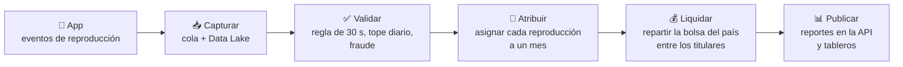

# Cómo funciona

:::tip En pocas palabras
Una reproducción viaja de la app a un reporte mensual de regalías en **cinco pasos**: capturar → validar → atribuir → liquidar → publicar.
:::

## 1. Capturar

La app envía pequeños eventos cada vez que alguien inicia, pausa, reanuda, salta o termina una pista. Cada evento tiene un ID único, así que si el teléfono lo envía dos veces se cuenta una sola. Los eventos entran a una cola durable y se guardan sin cambios en la capa **Bronze** del Data Lake. No se pierde nada, aunque un servidor se reinicie.

## 2. Validar

Los eventos se agrupan en sesiones de escucha y se revisan contra las reglas:

- Una reproducción es **válida** solo si se escucharon **30 segundos seguidos**.
- Solo se pagan las **10 primeras reproducciones válidas** por usuario, pista y día.
- Las cuentas que se comportan como **granjas de reproducciones** (demasiadas horas, un solo artista muy pequeño, muchas cuentas en un dispositivo) quedan en revisión.

El resultado limpio queda en la capa **Silver**.

## 3. Atribuir

Cada reproducción válida se asigna a un **mes de liquidación**. Las reproducciones offline (escuchadas sin internet y sincronizadas después) cuentan en el mes en que se escucharon si sincronizan hasta el día 2 del mes siguiente a las 23:59 UTC. Las que llegan después se pagan como **ajuste** en el siguiente mes abierto.

## 4. Liquidar

El **día 3** de cada mes la plataforma:

1. Arma una **bolsa por país**: el 52 % de la suscripción neta más el 45 % de los ingresos publicitarios.
2. Reparte la bolsa entre los titulares según su participación en las reproducciones válidas.
3. Aplica el **% contractual** de cada titular vigente en la fecha de cada reproducción.
4. Redondea al centavo de forma que el total nunca supere la bolsa.

El resultado va a la capa **Gold** y a la base de datos de reportes.

## 5. Publicar

- Los **titulares** entran a la API y ven solo su reporte, con el ID de la liquidación y las reproducciones que respaldan cada monto.
- Los equipos de **SonoraPlay** usan tableros de Power BI de regalías, consumo y churn.
- Un mes publicado **nunca se edita**. Una corrección crea una nueva versión de la liquidación, así la historia queda intacta.

## De dónde vienen los datos

| Fuente | Qué es | Ejemplo de uso |
|---|---|---|
| **F1** | Catálogo musical (dataset Spotify Tracks, Kaggle) | A qué titular pertenece cada pista |
| **F2** | Eventos de reproducción de la app (simulados) | Qué reproducciones son válidas |
| **F3** | Suscripciones, planes y pagos (PostgreSQL) | Ingreso por suscripción y país de facturación |
| **F4** | Contratos de los titulares (PostgreSQL) | % de regalía y países excluidos |
| **F5** | Ingresos publicitarios mensuales (CSV simulado) | Parte publicitaria de la bolsa |
| **F6** | Tasas de cambio (API Frankfurter) | Convertir moneda local a USD |
| **F7** | Información de países (API REST Countries) | Códigos de país y monedas |

Más detalle en [Datos](./data.md).
